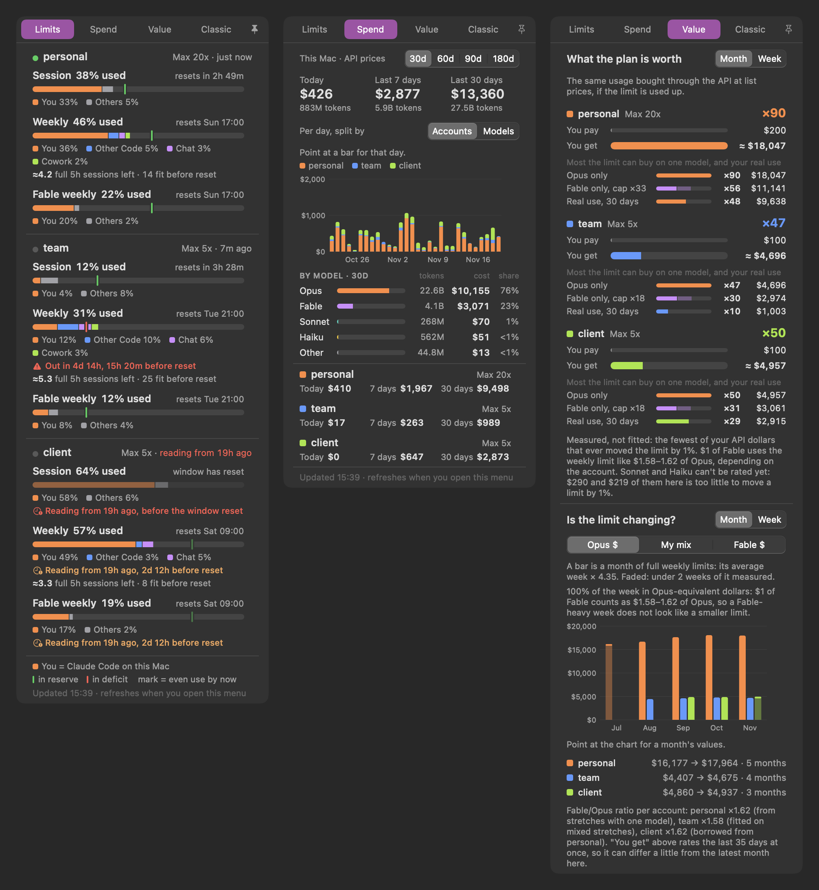
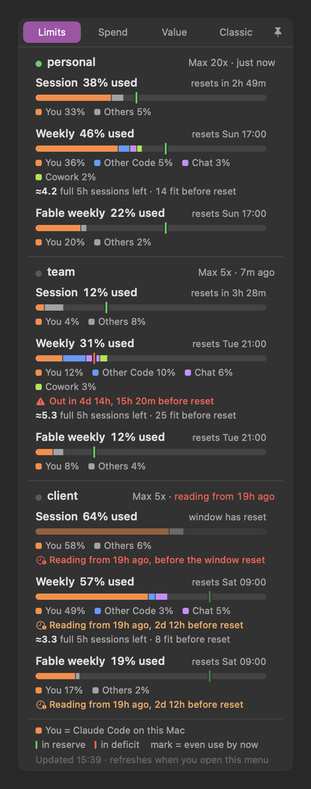
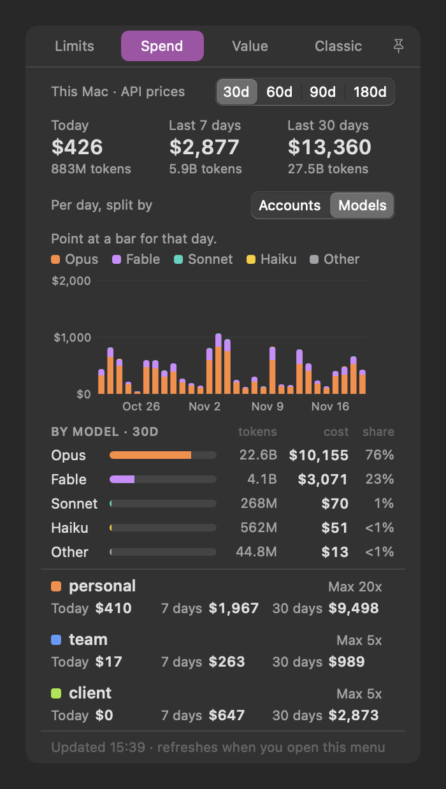
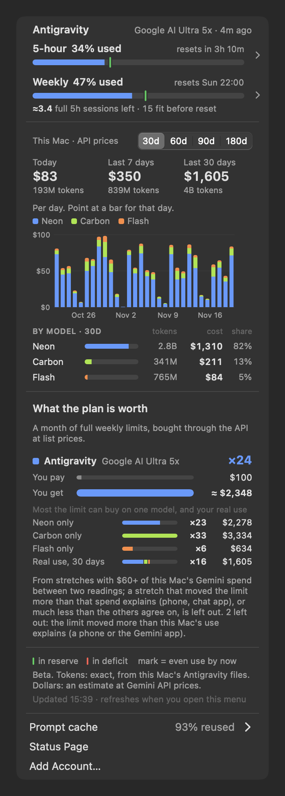
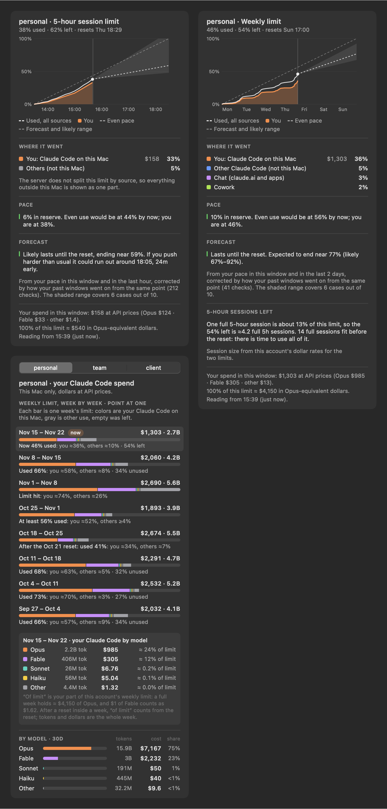

# CodexBar, multi-account build

**A fork of [CodexBar](https://github.com/steipete/CodexBar) for people who run several Claude accounts from one Mac.** Every saved account's 5-hour and weekly limits side by side, who used each limit, a forecast with a range, spend by account and model, what the plan is worth at API prices, and prompt-cache savings, in the menu bar.

  

Screenshots are rendered from made-up demo data.

> CodexBar is written by Peter Steinberger and is MIT licensed. This fork is not affiliated with or endorsed by its author. If stock CodexBar does what you need, use [the original](https://github.com/steipete/CodexBar): it updates itself and supports far more providers. Its own README is [here](../README.md).

## What this build adds

- **All Claude accounts at once.** Session, weekly and model-specific weekly limits of every saved account, refreshed in the background.
- **Who used the limit.** Each bar is split into: you in Claude Code on this Mac, other Claude Code, chat, Cowork.
- **Forecast, pace and sessions left.** A projection with a range checked against your own past windows; how many full 5-hour sessions are left before the weekly reset.
- **Spend.** API dollars and tokens per day, by account or by model, for 30 to 180 days; each past week as a part of the weekly limit.
- **Value.** A full limit at API list prices against the plan price, by month and by week.
- **Prompt cache.** Share read from the cache and dollars saved, per account.
- **Antigravity (beta).** Gemini quota, spend by model and plan value on one page.
- **One detail panel** that opens next to the menu on hover, in place of submenus.
- **Four pages** on the Claude tab, paged with the left and right arrows: Limits, Spend, Value, and Classic, which is the stock CodexBar card, unchanged.

  
  
  

## Stock CodexBar and this build

| | Stock CodexBar | This build |
|---|---|---|
| Claude accounts | The signed-in account; more through claude-swap or token accounts | Every saved account side by side |
| A limit bar | Percent used and reset time | Also split by who used it |
| Running out | "Runs out in…" and a pace bar | Projection with a range, full sessions left |
| Spend | Cost history per provider and model | Also per account, and weeks as parts of the limit |
| Plan value | Not shown | Full limit at API prices against the plan price |
| Prompt cache | Cache-read tokens in the token mix | Share read from cache and dollars saved |
| Details | Native submenus | One panel next to the menu |
| Updates | Automatic | A script that rebases onto the new release |
| Languages | Many | The added pages are English only |

## How it fits together

The added pages only draw. The numbers come from a small local collector that reads Claude Code's logs on this Mac and asks each saved account for its limits, and from **Claude Switcher**, a menu bar app that switches the Claude desktop app between saved accounts. Both live in the companion repository:

**[Lemelson/claude-switcher](https://github.com/Lemelson/claude-switcher)**: the switcher, the collector, how every number is measured, and the build, install and update scripts for this fork.

Without the collector's `state.json` the Claude tab shows the stock CodexBar card and CodexBar fetches the limits itself, as upstream does.

## Install

Requirements: macOS 14+, Xcode, Python 3. Follow the four commands in the [companion repository's Install section](https://github.com/Lemelson/claude-switcher#install); the last one builds this fork and replaces `/Applications/CodexBar.app`, keeping an archive of the previous app.

## Where the code is

- Branch `lemelson/accounts`, on top of an upstream release tag.
- `Sources/LemelsonUsageKit/`: the pages and panels (SwiftUI), no AppKit menu code.
- `Sources/CodexBar/Lemelson/`: paging, the detail panel, the hooks into the menu.
- `Sources/LemelsonPanelPreview/`: renders any page to a PNG off screen from a `state.json`.
- Changes inside upstream files are marked `// lemelson:`.

## Upstream

Parts that make sense for everyone are proposed to CodexBar as small separate pull requests. Bugs in what this fork adds belong in this repository's issues, not upstream's.

## License

MIT, like CodexBar: see [LICENSE](../LICENSE). The companion repository is Apache 2.0.
